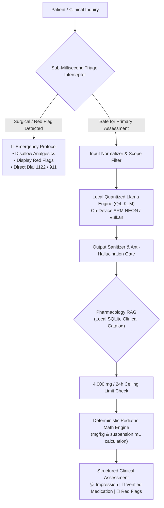

# Tabib AI (طبیب) — On-Device Clinical Intelligence System

<div align="center">


[](https://flutter.dev)
[](https://dart.dev)
[](#system-architecture)
[](LICENSE)
[](vercel.json)

**Air-gapped on-device clinical decision support and triage system powered by local quantized neural weights, deterministic pharmacology limits, and sub-millisecond emergency red-flag interceptors.**

[Web Demo & Landing Page](https://tabib-clinical.vercel.app) • [Direct Download Android APK (Google Drive)](https://drive.google.com/file/d/1b75-MXkmWT95j_rva-nWpe_EkNNAYgj3/view?usp=sharing)

</div>

---

## 🩺 Executive Overview

Modern healthcare delivery in remote, austere, or disaster-stricken environments is severely hindered by unreliable internet connectivity, proprietary cloud vendor lock-in, and strict HIPAA/GDPR patient data privacy restrictions. Furthermore, standard Large Language Models (LLMs) cannot be deployed safely in clinical workflows due to **unbounded dosage hallucinations, failure to account for pediatric weight equations, and accidental masking of surgical emergencies.**

**Tabib AI** addresses these failure modes by engineering a **zero-trust, dual-layered architecture**:
1. **Local Neural Reasoning Engine**: Executes 4-bit quantized medical LLM weights (`Q4_K_M`) directly on-device using native C++ llama bindings via ARM NEON and Vulkan GPU acceleration.
2. **Deterministic Pharmacology & Triage Guardrails**: Every token generated by the local neural model is validated against an air-gapped SQLite medical database and programmatic gatekeepers to enforce strict clinical ceiling limits and safe pediatric formulas.

---

## ⚡ Key Highlights

- **🔒 100% Air-Gapped Privacy**: Zero cloud telemetry, zero remote API calls. Patient clinical notes and triage queries never leave local hardware.
- **🛡️ Deterministic Ceiling Limits**: Enforces hard adult ceiling locks (e.g., 4,000 mg/24h Paracetamol threshold) preventing lethal hepatotoxicity recommendations.
- **👶 Dynamic Pediatric Math Engine**: Deterministic $mg/kg$ formula computation paired with exact commercial oral suspension ($mg/mL$) volumetric dosing.
- **🚨 Sub-Millisecond Triage Interceptor**: Instantly catches surgical abdomen (appendicitis, peritonitis), acute aortic dissection, stroke, and GI bleeding before model inference, disabling oral analgesics that mask symptoms.
- **🌐 Dual Target (Android & Flutter Web)**: Complete on-device offline app for Android smartphones, accompanied by an executive-grade Flutter Web landing page for zero-config Vercel hosting.

---

## 🏗️ System Architecture



---

## 💊 Deterministic Pharmacology & Pediatric Math

### 1. Paracetamol / Acetaminophen Toxicity Guard
Standard conversational LLMs frequently fail to compute total 24-hour drug load across concurrent brand names (e.g., Panadol + Calpol + Tylenol). Tabib AI integrates hard-coded programmatic locks:
* **Adult Ceiling**: **4,000 mg (4 grams / 8 &times; 500 mg tablets) per 24 hours**.
* **Automatic Overdose Scrubbing**: Any generated sentence or patient prompt mentioning doses $\ge 4.0\text{ g}$ is intercepted and sanitized with clinical warnings on hepatic glutathione depletion.

### 2. Pediatric Weight-Based Equations
Pediatric dosage calculations must never rely on probabilistic token generation. Tabib's `PediatricMathHelper` computes:
$$\text{Single Dose (mg)} = \text{Weight (kg)} \times 15\text{ mg/kg}$$
$$\text{Liquid Volume (mL)} = \frac{\text{Single Dose (mg)}}{120\text{ mg}} \times 5\text{ mL}$$
$$\text{Maximum 24h Ceiling} = \text{Weight (kg)} \times 60\text{ mg/kg/day}$$

---

## 🚀 Getting Started

### Prerequisites
- **Flutter SDK**: `^3.13.5` or `3.47+`
- **Dart SDK**: `^3.13.5`
- **Android NDK**: Version `25.1+` (for compiling native C++ llama bindings)
- **Node.js / Vercel CLI** (optional, for web hosting)

### Installation & Local Setup

```bash
# 1. Clone repository
git clone https://github.com/Khalidali-dev/Tabib-AI.git
cd Tabib-AI

# 2. Install Flutter packages
flutter pub get

# 3. Run on local Android device
flutter run -d <device-id>
```

---

## 📱 Building Android APKs

Because `llamadart` includes optimized C++ binaries for ARM and x86_64 architectures, **always build split APKs** for mobile deployment to reduce file size from ~268 MB to ~80 MB:

```bash
# Build per-ABI APKs (Recommended for physical devices)
flutter build apk --release --split-per-abi

# Direct Download:
# Google Drive Release APK: https://drive.google.com/file/d/1b75-MXkmWT95j_rva-nWpe_EkNNAYgj3/view?usp=sharing

# Target output:
# build/app/outputs/flutter-apk/app-arm64-v8a-release.apk (~85 MB)
```

For Google Play Store submission:
```bash
flutter build appbundle --release
```

---

## 🌐 Deploying to Vercel (Flutter Web)

Tabib AI includes zero-configuration deployment for [Vercel](https://vercel.com) via `vercel.json`:

```bash
# Build web output using CanvasKit renderer
flutter build web --release --web-renderer canvaskit

# Deploy via Vercel CLI
vercel --prod
```

### `vercel.json` Configuration:
```json
{
  "buildCommand": "flutter build web --release --web-renderer canvaskit",
  "outputDirectory": "build/web",
  "cleanUrls": true,
  "rewrites": [
    {
      "source": "/(.*)",
      "destination": "/index.html"
    }
  ],
  "headers": [
    {
      "source": "/(.*)",
      "headers": [
        {
          "key": "Cross-Origin-Embedder-Policy",
          "value": "require-corp"
        },
        {
          "key": "Cross-Origin-Opener-Policy",
          "value": "same-origin"
        }
      ]
    }
  ]
}
```

---

## 📂 Project Directory Structure

```text
lib/
├── data/
│   ├── datasources/
│   │   ├── medicine_local_db.dart    # Embedded SQLite clinical formulary
│   │   └── model_downloader.dart     # Resumable quantized GGUF downloader
│   └── models/
├── domain/
│   ├── entities/                     # ChatMessage, ChatSession, MedicineEntity
│   └── services/
│       ├── emergency_service.dart    # Multi-country dispatch (1122, 911, 999)
│       ├── medical_inference_service.dart # llama runtime engine
│       ├── output_sanitizer.dart     # Dosage ceilings & asterisk sanitizer
│       ├── pediatric_math_helper.dart# Deterministic mg/kg dosing engine
│       └── triage_interceptor.dart   # Red-flag & surgical gatekeeper
├── presentation/
│   ├── bloc/                         # Clean Architecture BLoC layer
│   ├── screens/
│   │   ├── chat_screen.dart          # Clinical triage consultation screen
│   │   ├── download_screen.dart      # Verification & weight management
│   │   ├── gateway_screen.dart       # Device weight verifier & routing
│   │   └── landing_page_screen.dart  # Executive Flutter Web landing page
│   ├── theme/
│   │   └── app_theme.dart            # Medical Teal & Slate theme system
│   └── widgets/                      # Micro-animations, responsive containers
└── main.dart                         # Entrypoint with platform-aware routing
```

---

## ⚖️ Clinical Disclaimer & Ethics

> [!IMPORTANT]
> **FOR CLINICAL DECISION SUPPORT & EDUCATIONAL PURPOSES ONLY**  
> Tabib AI is an algorithmic assistant designed to assist qualified healthcare professionals and triage officers in low-resource environments. It does not replace clinical physical diagnosis, laboratory testing, or physician consultation. In cases of acute chest pain, acute abdomen, stroke symptoms, or severe trauma, activate local emergency medical dispatch immediately.

---

## 📄 License

This software is licensed under the **Apache License 2.0**. See the [LICENSE](LICENSE) file for complete details.
